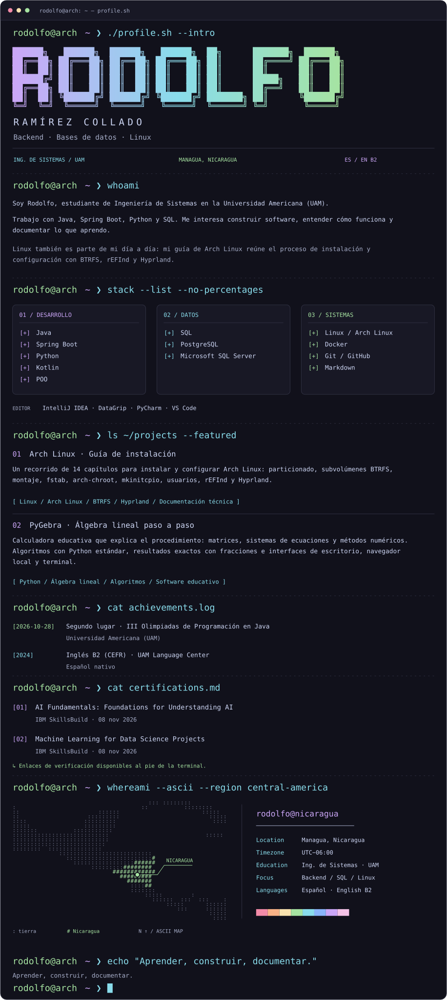

  

  <a href="mailto:rodolfo.cl@icloud.com">Correo</a> ·
  <a href="https://github.com/rodolfo-collado?tab=repositories">Repositorios</a> ·
  <a href="https://github.com/rodolfo-collado/arch-linux-installation-guide">Arch Linux</a> ·
  <a href="https://github.com/rodolfo-collado/Algebra-Lineal">PyGebra</a>

  Verificar certificados:
  <a href="https://www.credly.com/go/11Xy7fFd">AI Fundamentals</a> ·
  <a href="https://www.credly.com/badges/d75fdabe-5d13-4922-bb73-3db8127f002d">Machine Learning for Data Science Projects</a>

