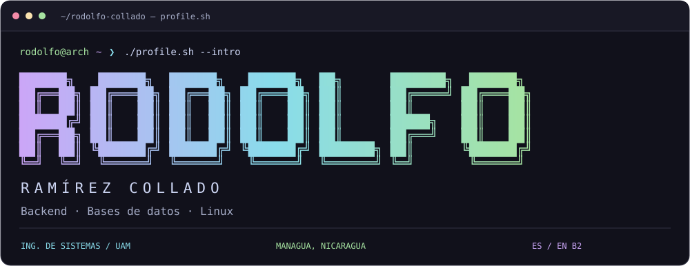
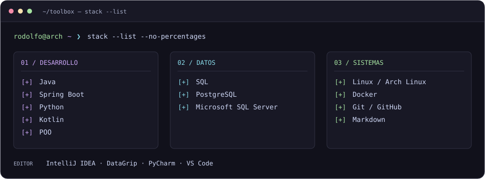
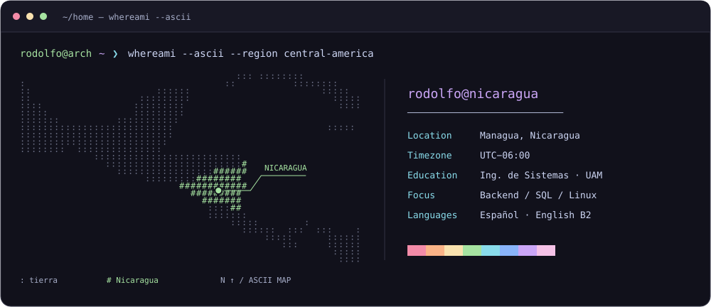

<p align="center">
  
</p>

### `~ ❯ whoami`

Soy **Rodolfo**, estudiante de Ingeniería de Sistemas en la Universidad Americana (UAM). Trabajo con **Java, Spring Boot, Python y SQL**, y me interesa construir software, entender cómo funciona y documentar lo que aprendo.

Linux también es parte de mi día a día: mi guía de Arch Linux reúne el proceso de instalación y configuración con **BTRFS, rEFInd y Hyprland**.

[Correo](mailto:rodolfo.cl@icloud.com) · [Repositorios](https://github.com/rodolfo-collado?tab=repositories) · [Guía de Arch Linux](https://github.com/rodolfo-collado/arch-linux-installation-guide)

### `~ ❯ stack --list`

<p align="center">
  
</p>

<details>
<summary>Ver tecnologías en texto</summary>

| Área | Tecnologías |
| :--- | :--- |
| Desarrollo | Java · Spring Boot · Python · Kotlin · Programación Orientada a Objetos |
| Bases de datos | SQL · PostgreSQL · Microsoft SQL Server |
| Sistemas y herramientas | Linux · Arch Linux · Docker · Git · GitHub · Markdown |
| Entorno de trabajo | IntelliJ IDEA · DataGrip · PyCharm · Visual Studio Code |

</details>

### `~ ❯ ls ~/projects --featured`

#### `01` [Arch Linux · Guía de instalación](https://github.com/rodolfo-collado/arch-linux-installation-guide)

Un recorrido de **14 capítulos** para instalar y configurar Arch Linux: particionado, subvolúmenes BTRFS, montaje, `fstab`, `arch-chroot`, `mkinitcpio`, usuarios, rEFInd y Hyprland.

`Linux` `Arch Linux` `BTRFS` `Hyprland` `Documentación técnica`

#### `02` [PyGebra · Álgebra lineal paso a paso](https://github.com/rodolfo-collado/Algebra-Lineal)

Calculadora educativa que explica el procedimiento: matrices, sistemas de ecuaciones y métodos numéricos. Algoritmos implementados con Python estándar, resultados exactos con fracciones e interfaces de escritorio, navegador local y terminal.

`Python` `Álgebra lineal` `Algoritmos` `Software educativo`

### `~ ❯ cat achievements.log`

- **Segundo lugar · III Olimpiadas de Programación en Java**, Universidad Americana (UAM) — 28 de octubre de 2026.
- **Inglés B2 (CEFR)** — UAM Language Center, 2024. Español nativo.

### `~ ❯ cat certifications.md`

| Certificación | Emisor | Fecha | Verificación |
| :--- | :--- | :--- | :--- |
| AI Fundamentals: Foundations for Understanding AI | IBM SkillsBuild | 08 nov 2026 | [Credly](https://www.credly.com/go/11Xy7fFd) |
| Machine Learning for Data Science Projects | IBM SkillsBuild | 08 nov 2026 | [Credly](https://www.credly.com/badges/d75fdabe-5d13-4922-bb73-3db8127f002d) |

### `~ ❯ whereami --ascii`

<p align="center">
  
</p>

```text
rodolfo@arch ~ ❯ echo "Aprender, construir, documentar."
Aprender, construir, documentar.
```
